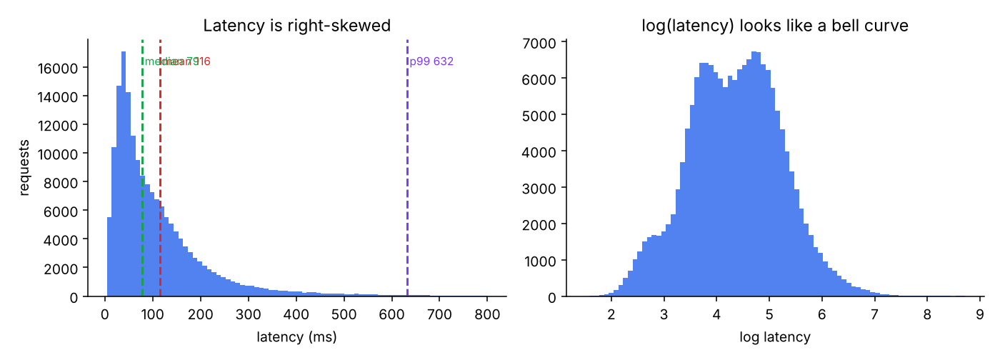
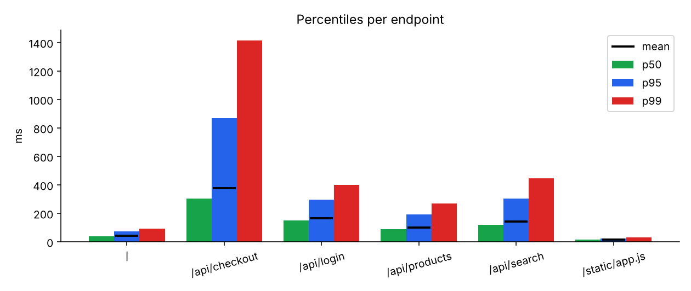
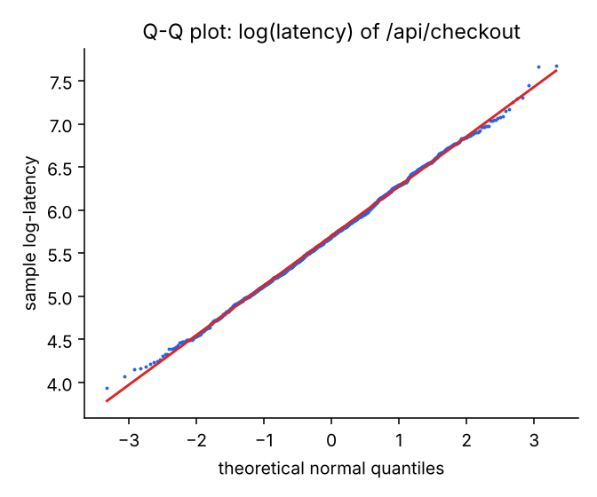
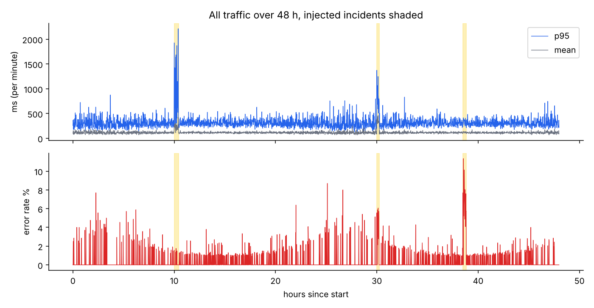
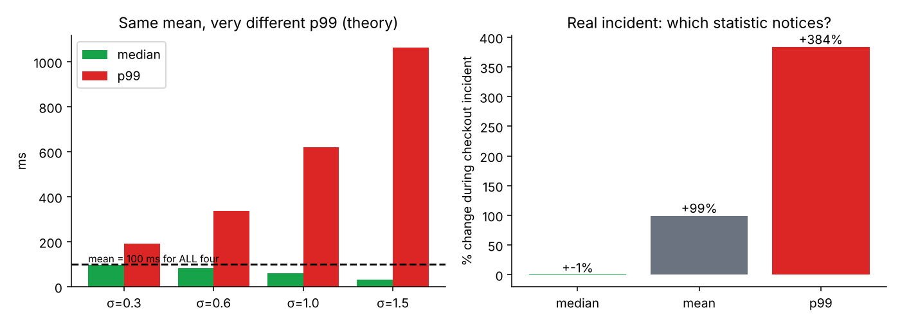
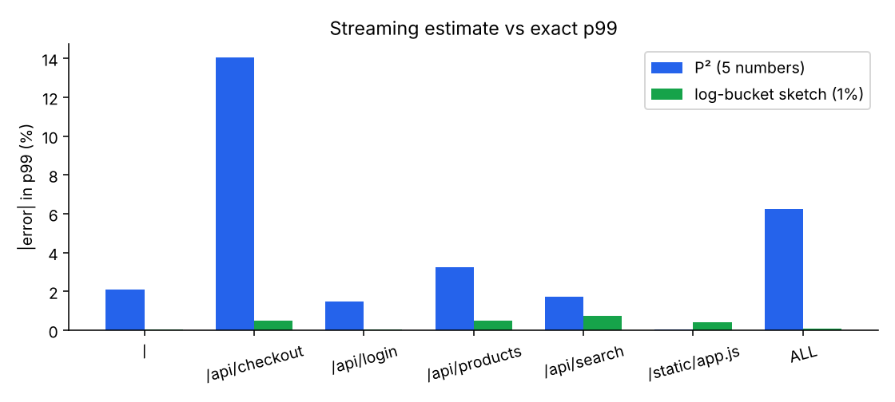
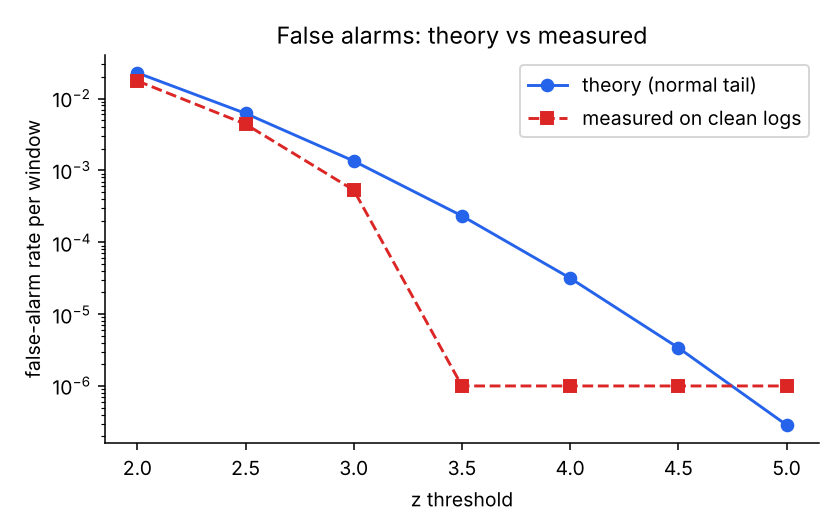

# 1. Problem and motivation
Site-reliability engineers watch **percentile latencies** (p50, p95, p99) because users feel the slow tail, not the average. Our task: load web-server logs into a database, compute latency distributions per endpoint, detect time windows where latency or error rate is abnormally high, and explain why the mean is a poor summary of latency.

**Questions.** (Q1) How far is the mean from the percentiles on skewed latency? (Q2) Which probability model describes latency? (Q3) Can a statistical rule find incidents without false alarms? (Q4) Do exact and streaming percentile estimates agree?

# 2. Data and schema
We used **synthetic logs with injected incidents** (allowed by the handbook). Arrivals follow a Poisson process with a daily cycle; each endpoint has lognormal latency. Seed 17 makes it reproducible: **172,866 requests over 48 h, 6 endpoints.** Three incidents were injected: a 25-minute checkout database slowdown (6x latency), a 15-minute global cache failure (3x latency, 3% extra errors) and a 20-minute search error burst (25% errors, latency only 1.3x). Because we know the truth, we can measure detection and false alarms.

**Schema:** `endpoints(endpoint_id, path)` 1-to-many `requests(request_id, ts, minute, ip, endpoint_id, status, bytes, latency_ms, is_error)`, plus `dq_log`. Indexes on `minute` and `(endpoint_id, latency_ms)`. Seven analytical queries (aggregation, joins, window functions `ROW_NUMBER`, `COUNT OVER`, rolling frame, `LAG`) are in `sql/queries.sql`.

**Data-quality log**

| Issue | Rows | Action |
|---|---|---|
| Malformed lines (regex mismatch / non-numeric latency) | 0 | Skipped and counted |
| Negative latency values | 0 | Dropped |
| Same ip+second+path repeated | 0 | Kept: plausible for real traffic; flagged only |
| Missing byte size ('-') | 0 | Would be set to 0 (none present in this data) |

# 3. Exploratory analysis
| Endpoint | n | mean ms | p50 | p95 | p99 | error rate |
|---|---|---|---|---|---|---|
| / | 52,061 | 42.7 | 40.0 | 71.7 | 92.8 | 0.23% |
| /api/checkout | 13,797 | 376.9 | 304.3 | 868.0 | 1415.4 | 0.65% |
| /api/login | 17,298 | 165.2 | 150.6 | 296.2 | 399.3 | 0.83% |
| /api/products | 34,557 | 100.1 | 89.7 | 191.0 | 269.1 | 0.31% |
| /api/search | 42,915 | 141.1 | 120.7 | 301.8 | 444.7 | 0.62% |
| /static/app.js | 12,238 | 15.8 | 15.1 | 24.5 | 31.0 | 0.08% |
| ALL | 172,866 | 115.6 | 78.6 | 323.3 | 632.2 | 0.42% |

Across all traffic the skewness is 7.4; 34% of requests are slower than the mean and p99 is 5.5x the mean.

{width=95%}

{width=90%}

# 4. Methods and justification
- **Percentiles** (exact, via SQL window functions and NumPy). The SQL nearest-rank values agree with NumPy to within one rank.
- **Distribution fitting:** lognormal (MLE of mean and sd of log-latency) versus exponential (MLE rate), compared with AIC and the Kolmogorov-Smirnov distance, fitted only on windows our detector did not flag.
- **Latency detector:** per endpoint and 5-minute window (n >= 10), z = (median of log-latency - baseline) / (1.2533 sigma / sqrt(n)). The factor 1.2533 is the standard error of a sample median under normality. Alert if z >= 4 (one-sided p = 3.2e-5).
- **Error detector:** exact one-sided binomial test of errors against the endpoint's normal error rate, Bonferroni-corrected across all windows (family alpha = 0.01).
- **Streaming detector:** per-minute p95 against a rolling 60-minute median kept with two heaps; alert after 3 consecutive minutes above 2x.
- **Tests on incidents:** Mann-Whitney U (latency is skewed, so rank-based), Welch t on log-latency as cross-check, two-proportion z-test for error rates, bootstrap confidence intervals.

# 5. Results
## 5.1 Distribution fit
| Endpoint | sigma | AIC gap (exp - lognormal) | KS lognormal | KS exponential | p99 theory | p99 empirical |
|---|---|---|---|---|---|---|
| / | 0.351 | 71,677 | 0.004 | 0.360 | 90 | 90 |
| /api/checkout | 0.600 | 7,423 | 0.005 | 0.224 | 1216 | 1200 |
| /api/login | 0.401 | 19,839 | 0.007 | 0.332 | 384 | 386 |
| /api/products | 0.450 | 33,179 | 0.005 | 0.304 | 256 | 259 |
| /api/search | 0.549 | 28,097 | 0.002 | 0.249 | 430 | 433 |
| /static/app.js | 0.299 | 20,313 | 0.011 | 0.394 | 30 | 30 |

The lognormal is preferred by thousands of AIC points on every endpoint and its KS distance is near zero; the exponential is clearly wrong for latency. Predicted p99 is within about 1.4% of the empirical p99.

{width=50%}

## 5.2 Incident detection
{width=95%}

| Incident | Endpoint | Start | Detection delay | Detected |
|---|---|---|---|---|
| checkout-db-slowdown | /api/checkout | 10.0 h | 5.0 min | yes |
| global-cache-failure | ALL | 30.0 h | 5.0 min | yes |
| search-error-burst | /api/search | 38.5 h | 5.0 min | yes |

All **3 of 3** incidents were found, with **0 false alerts** on the original data and **0 false alerts across 8 incident-free days**. The streaming p95 rule caught the two latency incidents but, as expected, missed the error burst (latency barely changed): the error-rate test is needed for that one.

## 5.3 Hypothesis tests
- **Checkout latency, incident vs baseline hour:** median 308 ms to 1593 ms (ratio 5.2, 95% CI 4.3 to 6.2); Mann-Whitney p = 2.1e-59; a random incident request is slower than a random baseline request with probability 0.98.
- **Search error rate:** 0.40% to 24.7% (difference 24.3 points, 95% CI 20.4 to 28.2); two-proportion z = 42.2, p < 1e-300.
- A tiny p-value alone says "something changed"; the effect sizes and intervals say *how much*.

# 6. Theory vs experiment
## 6.1 The mean hides a bad p99
**Theory.** For a lognormal, mean = exp(mu + sigma^2/2) but p99 = exp(mu + 2.326 sigma). With the mean fixed at 100 ms:

| sigma | mean | median | p95 | p99 |
|---|---|---|---|---|
| 0.3 | 100 | 95.6 | 157 | 192 |
| 0.6 | 100 | 83.5 | 224 | 337 |
| 1.0 | 100 | 60.7 | 314 | 621 |
| 1.5 | 100 | 32.5 | 383 | 1063 |

**Experiment.** During the checkout incident (8% of traffic), for all traffic the median changed -1%, the mean +99%, and p99 +384% (638 to 3086 ms). Making only 1% of requests 20x slower raises the mean by 19% and p99 by 48%, while the median does not move.

{width=95%}

## 6.2 Exact percentiles vs streaming estimates (all traffic, 172,866 values)
| Percentile | Exact | P-square (5 numbers) | Log-bucket sketch (1%, 331 buckets) |
|---|---|---|---|
| p50 | 78.6 | 78.6 (+0.1%) | 79.1 (+0.57%) |
| p95 | 323.3 | 324.0 (+0.2%) | 320.6 (-0.84%) |
| p99 | 632.2 | 671.6 (+6.2%) | 632.8 (+0.10%) |

The sketch honours its 1% guarantee. P-square is least accurate here because the mixed, time-ordered stream is not stationary (a weakness worth stating in the viva).

{width=75%}

## 6.3 False-alarm rate: theory vs measurement (stretch goal)
Window medians of log-latency are approximately normal, so a threshold z should alarm on a fraction 1 - Phi(z) of normal windows. We calibrated on the original data and tested on 4 new incident-free two-day logs (13,188 windows):

| z | theory rate | measured rate | measured / expected count | power on injected incidents |
|---|---|---|---|---|
| 2.0 | 2.28e-02 | 1.76e-02 | 232 / 300.0 | 100% |
| 2.5 | 6.21e-03 | 4.40e-03 | 58 / 81.9 | 100% |
| 3.0 | 1.35e-03 | 5.31e-04 | 7 / 17.8 | 100% |
| 3.5 | 2.33e-04 | 0.00e+00 | 0 / 3.1 | 96% |
| 4.0 | 3.17e-05 | 0.00e+00 | 0 / 0.4 | 88% |
| 4.5 | 3.40e-06 | 0.00e+00 | 0 / 0.0 | 85% |
| 5.0 | 2.87e-07 | 0.00e+00 | 0 / 0.0 | 85% |

Measured false alarms sit at or below theory: small windows and a robust sigma make the normal approximation conservative in the tail. Raising z lowers false alarms but also lowers power (z = 4 catches 88% of incident windows, all incidents overall), the classic false-positive / false-negative trade-off.

{width=60%}

# 7. Interpretation for a non-technical reader
The average page time hides trouble. Half of visitors get a page in about 79 ms, but one visitor in a hundred waits over 600 ms, and during an incident that slow group waits several seconds while the average only doubles. Our alert rule watched the site in 5-minute slices and told us about every injected problem within a window, without crying wolf on normal days. Reporting p95 and p99, not the mean, is what keeps users happy.

# 8. Limitations and future work
- Synthetic data: real logs (for example NASA HTTP logs) have bursts, bots and load-dependent latency that we did not model.
- Latency is independent of load in our generator; real systems slow down when busy.
- Only two days, so weekly patterns are untested; the baseline is estimated from the same data it monitors (we mitigated with a two-pass trimmed estimate and a clean holdout).
- Next: run on the NASA logs, add seasonality-aware baselines, compare with an Isolation Forest, add a t-digest.

# 9. Appendix
**AI-tool disclosure.** This project was built with assistance from Claude (Anthropic) for code, analysis and drafting. The group reviewed the work and is responsible for it.

**References.** Jain and Chlamtac (1985) P-square algorithm; Masson, Rim and Lee (2019) DDSketch; Dean and Barroso (2013) *The Tail at Scale*; SciPy and NumPy documentation.
